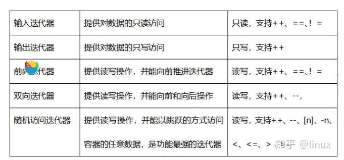

### 1.什么是迭代器
1.1 概念：
迭代器是一种检查容器内元素并遍历元素的数据类型，通常用于对C++中各种容器内元素的访问，但不同的容器有不同的迭代器，初学者可以将迭代器理解为指针。

### 2.迭代器类型以及功能

2.1. 迭代器的通用功能
* 比较两个迭代器是否相等（==、!=）。
* 前置和后置递增运算（++）。
* 读取元素的解引用运算符（*）。只能读元素，也就是解引用只能出现在赋值运算符的右边。
* 箭头运算符（->），解引用迭代器，并提取对象的成员。


| 类型                               | 功能                              |
|----------------------------------|---------------------------------|
| 输入迭代器(input iterator)            | 只能利用迭代器进行输入功能 <br/> 它只能用于单遍扫描算法 |
| 输出迭代器(output iterator)           | 只能利用迭代器进行输入功能<br/>只能用于单遍扫描算法    |
| 前向迭代器(forward iterator)          | 能利用迭代器进行输入和输出功能<br/>能用于多遍扫描算法   |
| 双向迭代器(bidirectional iterator)    |   能利用迭代器进行输入和输出功能<br/>能用于多遍扫描算法<br/>前置和后置递减运算（- -）,这意味这它能够双向访问|
| 随机访问迭代器(random access iterator)  |能利用迭代器进行输入和输出功能<br/>前置和后置递减运算（- -）（意味着它是双向移动的）<br/>比较两个迭代器相对位置的关系运算符（<、<=、>、>=）<br/>支持和一个整数值的加减运算（+、+=、-、-=）<br/>两个迭代器上的减法运算符（-），得到两个迭代器的距离<br/>支持下标运算符（iter[n]），访问距离起始迭代器n个距离的迭代器指向的元素 <br/>能用于多遍扫描算法。 在支持双向移动的基础上，支持前后位置的比较、随机存取、直接移动n个距离|



### 3.常见容器的迭代器

* vector   ———————> random access iterator
* deque    ———————> random access iterator
* list     ———————> bidirectional iterator
* set      ———————> bidirectional iterator
* multiset ———————> bidirectional iterator
* map      ———————> bidirectional iterator 
* multimap ———————> bidirectional iterator
* stack    ———————> 不支持迭代器
* queue    ———————> 不支持迭代器

### 4.源码分析
**category的五类迭代器以及继承关系**

```c++
struct input_iterator_tag {};
struct output_iterator_tag {};
struct forward_iterator_tag : public input_iterator_tag {};
struct bidirectional_iterator_tag : public forward_iterator_tag {};
struct random_access_iterator_tag : public bidirectional_iterator_tag {};
```
这五个类都是空类, 只是为了之后<font color=red>调用时通过类选择不同的重载函数.</font>  
**继承是为了可以使用传递调用，<font color=red>当不存在某种迭代器类型匹配时编译器会依据继承层次向上查找进行传递**</font> , 就可以通过继承关系来决定选择最优的调用. 我们通过用`distance`来讲最优

`distance`是用于计算连个迭代器之间的距离, 因为重载就可以通过不同的迭代器类型选择不同的函数来提高效率.

这里`distance`的`iterator_category`函数是每个迭代器自己定义的,

```c++
template <class InputIterator, class Distance>
inline void distance(InputIterator first, InputIterator last, Distance& n) 
{
  	__distance(first, last, n, iterator_category(first));
}
	
template <class InputIterator, class Distance>
inline void __distance(InputIterator first, InputIterator last, Distance& n, 
                       input_iterator_tag) 
{
  	while (first != last) 
    { ++first; ++n; }
}

template <class RandomAccessIterator, class Distance>
inline void __distance(RandomAccessIterator first, RandomAccessIterator last, 
                       Distance& n, random_access_iterator_tag) 
{
  	n += last - first;
}
```

从`distance`源码可以看出来不同的迭代器的计算方式并不一样, `random_access_iterator_tag`的距离的计算效率最高, 其他都是通过`++`操作来依次访问. 当然`random_access_iterator_tag`类的迭代器也是可以调用`input_iterator_tag`, 但是显然效率很低, 所以**不同的迭代器最自己最佳的效率**. 通过`iterator_category`进行最优选择.