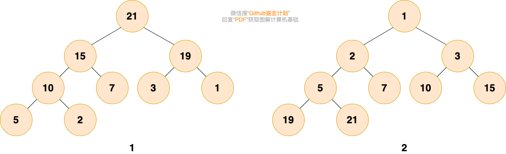
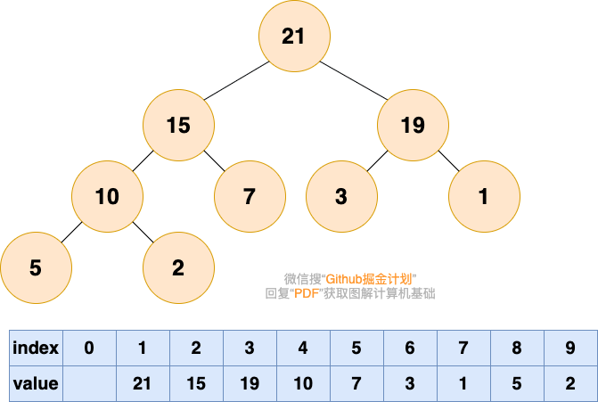

# 堆
### 一、堆简介
堆是一种满足以下条件的树：

堆中的每一个节点值都大于等于（或小于等于）子树中所有节点的值。

或者说，任意一个节点的值都大于等于（或小于等于）所有子节点的值。

### 二、堆的分类
堆分为 最大堆 和 最小堆。二者的区别在于节点的排序方式。

* 最大堆：堆中的每一个节点的值都大于等于子树中所有节点的值
* 最小堆：堆中的每一个节点的值都小于等于子树中所有节点的值

如下图所示，图 1 是最大堆，图 2 是最小堆

### 三、堆的存储

定义堆如下：
n个元素的序列$$\{{d_1,d_2,...,d_i,d_{i+1},...d_n}\}$$
当且仅当满足下列关系时，称之为堆
$$ \begin{cases}
    d_i < d_{2i} \\
     d_i < d_{2i+1}
    \end{cases}
$$
$$ or $$
$$ \begin{cases}
d_i > d_{2i} \\
d_i > d_{2i+1}
\end{cases}
$$

注意：堆可以看作完全二叉树，则满足如下条件:
* 若当前节点的下标是 $i$,则其父亲节点的下标为 $i/2$
* 若当前节点的下标是 $i$,则其左子节点的下标为 $i*2$,其右子节点的下标为$i*2+1$

    
### 四、堆的操作

